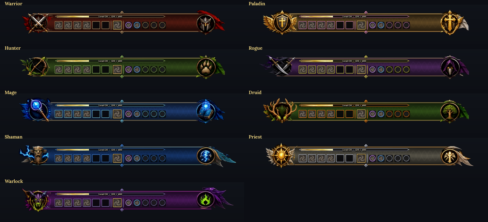
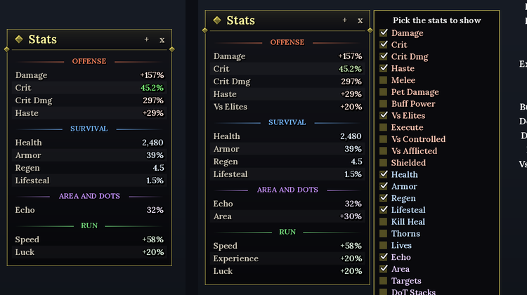

# Creed UI

A clean, smooth HUD for **Azeroth Survivors** ([wow.aethus.pl](https://wow.aethus.pl)), the World of Warcraft 1.12 roguelike. Everything wears **the class you play**: dark glass in your class's color, its metal on every frame, and its own emblem and crest on the skill bar. It all steps aside while you pick your cards.

## Install

1. Download the latest `CreedUi-<version>.zip` from [Releases](../../releases) (or install it from SurvivorsForge).
2. Unzip it into your game's `Interface/AddOns` folder. You should end up with `Interface/AddOns/CreedUI/CreedUI.toc`.
3. The folder must stay named `CreedUI`: the game loads it by that name, and your settings are kept under it.

Click the **C** on the minimap's edge (or type `/creed`) for the options.

## Your class's look

As each run starts, Creed UI takes on the class of the hero you start it with: the skill bar's glass in the class's color, its gold rail lines, and its emblem and crest on the ends.

| Class | Left end | Right end |
| --- | --- | --- |
| Warrior | crossed swords on a red cape | a helm |
| Paladin | a winged shield with a cross | a golden cross |
| Hunter | a bow in a ring of leaves | a paw |
| Rogue | two crossed daggers in purple smoke | a hood |
| Mage | an arcane staff in a rune circle | a spell book |
| Druid | antlers round a leaf | a tree |
| Shaman | a carved totem in lightning | lightning in a gold ring |
| Priest | a radiant sun with wings | a winged light |
| Warlock | a horned fel demon | a fel flame |

## What's in it

**The run**
- **Boss timer:** a countdown to each boss in each zone's own colors, with the run's time.
- **Boss and mini-boss bars:** real health numbers and the debuffs on them.
- **Skulls and cache marks:** a horned, red-eyed skull over each boss, a bone one over each guardian, and a gold chest over each cache, wherever they are on screen.
- **Loot pop-up:** each drop and the marks you earn, in its rarity's color (Tier 0.5 and Ahn'Qiraj and Naxxramas armor in purple, their weapons in orange), with whether it's new to your collection.
- **Run summary:** your time, level, kills, bosses, damage and gold when a run ends.

**You and your party**
- **Your frame and your target:** portraits in metal rings; a boss you target wears the gold elite dragon, a guardian the silver one.
- **Party frames:** in class colors, with your friends' shields on their health; right-click a friend to inspect, follow or whisper them.
- **Damage taken and heals:** red and green numbers rising beside your hero.
- **Downed friends (co-op):** a warning, a glowing mark where you can revive them, and an arrow to them when they're off screen.

**Your skills**
- **Skill bar:** your abilities with their ranks, how many of each are out (totems, Blizzards...), your jewelry and XP a second, in your class's look.
- **Pet bar:** your pets and summons, how many and how long they last, and what each of their skills hits for (hover for the details).
- **Stored level-ups:** a glowing Level Up! button with how many wait.
- **Talent window:** your trees, points and learned talents (`/creed talents`).

**Numbers and meters**
- **Damage numbers:** calm and readable, in four motions (Smooth, Fountain, Rise, Impact) and ten fonts, with a backdrop behind crits if you like (Fire, Frost, Arcane, Holy, Shadow, Storm); a spell hitting a crowd adds up into one number.
- **Damage meter:** Damage Done, Healing Done, Boss Damage, Party DPS (with each player's best skill) and Damage Taken; every pet's skills on one Pet line.
- **Luck medallion:** your luck and the odds of a Rare, Epic or Legendary card.
- **Stats window:** your run's stats at a glance, grouped (Offense, Survival, Area and DoTs, Run); a stat glows green as it rises and red as it falls, and the **+** picks which of the 29 stats it shows.

**Everything else**
- **Minimap:** a metal ring, your local time, the caches and the guardians' lairs.
- **Character window:** gear slots lit in their rarity color and your run's stats grouped beside it.
- **Tiny Plates:** compact nameplates for regular enemies, full-size ones for bosses and guardians.
- **Chat:** dressed to match, kept clear of the skill bar's emblem, and movable and resizable.

Every part can be turned on or off, sized and moved.

**Languages:** English, French, German, Spanish, Portuguese, Chinese, Russian, Japanese, Korean, Polish and Turkish, picked from the options or with `/creed language`.

## What's new

- **1.24:** the shaman's lightning crest.
- **1.23:** emblems and crests sharper and whole (solid faces, every flag and cape), the rogue's daggers, the hunter's bow, the warlock's fel flame.
- **1.22:** the **Stats window**; the skill bar's glass in your class's color.
- **1.21:** **your class's look** (following the class you start the run with), the class emblems and crests, and the game's elite and rare dragons on your target.

Every version's changes are in the [changelog](CHANGELOG.md).

## Commands

| Command | What it does |
| --- | --- |
| `/creed` | Opens the options (or click the C on the minimap's edge) |
| `/creed move`, `/creed lock` | Frees the frames to drag them (the chat too), then locks them |
| `/creed reset` | Puts every frame back in its place |
| `/creed language <code>` | Picks the language (`auto` follows the game) |
| `/creed timer ...`, `/creed numbers ...` | The boss timer's and damage numbers' own settings |
| `/creed <part> on/off` | Turns a part on or off (`stats`, `luck`, `meter`...) |
| `/creed talents` | Opens the talent window |
| `/creed probe` | Prints what the game gives addons, for reporting what's missing |

## What's in this repository

| Folder or file | What it is |
| --- | --- |
| [`CreedUI/`](CreedUI) | The addon itself: exactly what goes in the release zip |
| [`dev/`](dev/README.md) | Tools to build and check it: a stand-in game client with its tests, translations, art and font scripts, a preview renderer (and the pictures on this page, in `dev/art/showcase`) |
| [`CHANGELOG.md`](CHANGELOG.md) | What changed in each version |
| [`CLAUDE.md`](CLAUDE.md) | Notes for developers: how the code is organized and the rules it follows |
| `.github/workflows/` | **Release** (Actions → Release → Run workflow builds and publishes a version) and the nameplates' tests |

## Credits

Original art made for Creed UI; the skill bar's class emblems, crests and rails are cut from pictures made for the author. The bundled fonts in `CreedUI/Fonts` are made from Lora and Noto Sans CJK, both under the SIL Open Font License (see `CreedUI/Fonts/LICENSE.txt`); the damage numbers' fonts (Cinzel, Bangers, Creepster, Uncial Antiqua, Black Ops One, Pirata One) are under the same license (see `CreedUI/Fonts/NumberFonts-LICENSE.txt`). Tiny Plates is based on Valorless's MIT-licensed ASTinyPlates (see `CreedUI/TinyPlates-LICENSE.txt`), brought in by JamieeLee.
