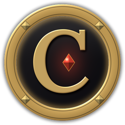

# Creed UI

A clean, smooth HUD for **Azeroth Survivors** ([wow.aethus.pl](https://wow.aethus.pl)), the World of Warcraft 1.12 roguelike. Everything is drawn in one look (dark glass, a bronze-gold rail, the boss timer's metal) and steps aside while you pick your cards.

## Install

1. Download the latest `CreedUi-<version>.zip` from [Releases](../../releases) (or install it from SurvivorsForge).
2. Unzip it into your game's `Interface/AddOns` folder. You should end up with `Interface/AddOns/CreedUI/CreedUI.toc`.
3. The folder must stay named `CreedUI`: the game loads it by that name, and your settings are kept under it.

Click the **C** on the minimap's edge (or type `/creed`) for the options.

## What's in it

**The run**
- **Boss timer:** a countdown to each boss in each zone's own colors, with the run's time.
- **Boss and mini-boss bars:** real health numbers and the debuffs on them.
- **Skulls and cache marks:** a horned, red-eyed skull over each boss, a bone one over each guardian, and a gold chest over each cache, wherever they are on screen.
- **Loot pop-up:** each drop and the marks you earn, in Creed UI's look, with whether the gear is new to your collection.
- **Run summary:** your time, level, kills, bosses, damage and gold when a run ends.

**You and your party**
- **Your frame, your target and your party:** in class colors, portraits in metal rings.
- **Damage taken and heals:** red and green numbers rising beside your hero.
- **Downed friends (co-op):** a warning, a glowing mark where you can revive them, and an arrow to them when they're off screen.

**Your skills**
- **Skill bar:** your abilities with their ranks, how many of each are out (totems, Blizzards...), your jewelry and XP a second, on a gold panel with a painted dragon on each end.
- **Pet bar:** your pets and summons, how many and how long they last, and what each of their skills hits for.
- **Stored level-ups:** a glowing Level Up! button with how many wait.
- **Talent window:** your trees, points and learned talents (`/creed talents`).

**Numbers and meters**
- **Damage numbers:** calm and readable, in four motions (Smooth, Fountain, Rise, Impact); a spell hitting a crowd adds up into one number.
- **Damage meter:** Damage Done, Healing Done, Boss Damage, Party DPS (with each player's best skill) and Damage Taken; every pet's skills on one Pet line.
- **Luck medallion:** your luck and the odds of a Rare, Epic or Legendary card.

**Everything else**
- **Minimap:** a metal ring, your local time, the caches and the guardians' lairs.
- **Character window:** gear slots lit in their rarity color and your run's stats grouped beside it.
- **Tiny Plates:** compact nameplates for regular enemies, full-size ones for bosses and guardians.
- **Chat:** dressed to match, and kept clear of the skill bar's dragon.

Every part can be turned on or off, sized and moved (the chat too).

**Languages:** English, French, German, Spanish, Portuguese, Chinese, Russian, Japanese, Korean, Polish and Turkish, picked from the options or with `/creed language`.

## Commands

| Command | What it does |
| --- | --- |
| `/creed` | Opens the options (or click the C on the minimap's edge) |
| `/creed move`, `/creed lock` | Frees the frames to drag them (the chat too), then locks them |
| `/creed reset` | Puts every frame back in its place |
| `/creed language <code>` | Picks the language (`auto` follows the game) |
| `/creed timer ...`, `/creed numbers ...` | The boss timer's and damage numbers' own settings |
| `/creed <part> on/off` | Turns a part on or off |
| `/creed talents` | Opens the talent window |
| `/creed probe` | Prints what the game gives addons, for reporting what's missing |

## What's in this repository

| Folder or file | What it is |
| --- | --- |
| [`CreedUI/`](CreedUI) | The addon itself: exactly what goes in the release zip |
| [`dev/`](dev/README.md) | Tools to build and check it: a stand-in game client with its tests, translations, art and font scripts, a preview renderer |
| [`CHANGELOG.md`](CHANGELOG.md) | What changed in each version |
| [`CLAUDE.md`](CLAUDE.md) | Notes for developers: how the code is organized and the rules it follows |
| `.github/workflows/` | **Release** (Actions → Release → Run workflow builds and publishes a version) and the nameplates' tests |

## Credits

Original art made for Creed UI. The bundled fonts in `CreedUI/Fonts` are made from Lora and Noto Sans CJK, both under the SIL Open Font License (see `CreedUI/Fonts/LICENSE.txt`). Tiny Plates is based on Valorless's MIT-licensed ASTinyPlates (see `CreedUI/TinyPlates-LICENSE.txt`), brought in by JamieeLee.
